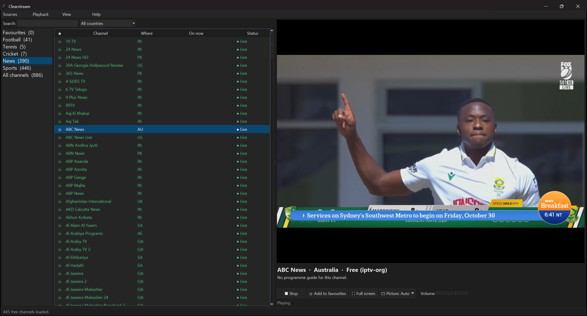

# Clearstream

A small TV player for Windows 11. It shows legitimate free channels, grouped into **Football, Tennis,
Cricket and News**, plus any paid IPTV service you add later. Video plays through **VLC's playback
engine** (libVLC), the same engine as the VLC media player, so the hard part, smooth playback, is
handled by proven software rather than something home-made.

**Why it's built this way:** Python + libVLC gives a reliable, widely used playback engine with only
*one* small add-on package (VideoLAN's official `python-vlc`). There's very little to install, and
little that could go wrong or be tampered with.

---

## 1. Install (about 10 minutes, once)

You need two free programs from their official websites. Download them **only** from the addresses
below; ignore "download" buttons on any other site.

### Step 1: Install Python
1. Go to **https://www.python.org/downloads/windows/**
2. Click the newest **"Windows installer (64-bit)"** for Python 3.12 or 3.13.
3. Run it. **On the first screen, tick "Add python.exe to PATH"**, then click **Install Now**.

*(Already installed on this PC: Python 3.12, 64-bit.)*

### Step 2: Install VLC
1. Go to **https://www.videolan.org**
2. Click **Download VLC**. Make sure it's the **64-bit Windows** version (the default).
3. Run it and accept the defaults.

*(Already installed on this PC: VLC 3.0.24, 64-bit.)*

### Step 3: Set up Clearstream
1. Put the **Clearstream** folder wherever you like, for example `Documents\Clearstream`.
2. Open it and **double-click `Setup.bat`**.
3. A black window checks Python and VLC, installs the one add-on, and puts a **Clearstream** icon on your
   desktop. When it says **All done**, press any key.

If Windows shows "Windows protected your PC", click **More info → Run anyway**. Windows shows this
for any script it hasn't seen before. `Setup.bat` is a plain text file; you can open it in Notepad and
read every line.

### Step 4: Start it
Double-click the **Clearstream** icon on your desktop (or `Start Clearstream.bat` in the folder).

---

## 2. Using it

| To… | Do this |
|---|---|
| Watch a channel | Pick a group on the left (Football, Tennis, Cricket, News, Sports…), then **double-click** a channel |
| Find a channel | Type in **Search** (searches every channel; clear the box to go back to the group) |
| Show one country only | Use the **All countries** drop-down |
| Add / remove a favourite | Click the **☆** next to a channel, or the **Add to favourites** button while watching |
| Full screen | **F11**, the **Full screen** button, or double-click the video. **Esc** to leave |
| Dark mode | **View → Dark mode**, or press **Ctrl+D**. Clearstream remembers your choice |
| Picture looks squashed or has black bars | Use the **Picture** button under the video: Auto, 16:9, 4:3, Fill screen or Original. Clearstream remembers your choice for each channel |
| Smoother playback on poor internet | **Playback → Buffer: Long** |
| Re-check which channels work | **Playback → Check channels in this list now** |

**What the Status column means**

- **● Live**: checked in the last few hours and working.
- **✕ Offline**: didn't work when checked (greyed out, at the bottom of the list). It's still clickable,
  because channels sometimes come back.
- **· Not checked**: not tested yet.

When the app opens, it checks all free channels in the background (about 1–2 minutes). The checker
loads a real piece of video, not just the channel's address, so channels that are **blocked in your
country** also show as Offline.

**What happens when a stream drops:**
1. VLC keeps about 15 seconds of video in reserve, so short internet hiccups don't interrupt anything.
2. If the picture stops, Clearstream reconnects by itself (after 2, 5, then 10 seconds).
3. If the channel has backup streams, it switches to the next one automatically.
4. Once a channel has been playing, it keeps trying for up to **3 minutes** before giving up. It never
   marks a channel Offline just because *your* internet dropped.

The status line under the video always says what's happening, e.g. "Switching to backup stream 2 of 3…".

**Programme guide (Now / Next):** shown under the video and in the **On now** column wherever the source
provides one. Paid services usually do (it's loaded automatically). The free channels mostly **don't**:
the free list has no guide data. You can add a guide address yourself with
**Sources → Add programme guide**.

---

## 3. Adding your paid service later

Only add a service you actually pay for. Your provider gives you **one** of these:

**A) An M3U playlist address** (a long link, often ending in `.m3u` or containing `get.php`)
→ **Sources → Add paid playlist (M3U web address)…**, give it a name, paste the link, **Save**.

**B) An Xtream login** (a server address, username and password)
→ **Sources → Add paid service (Xtream login)…**, fill in the four boxes, **Save**.

**C) A playlist file** you downloaded from your provider's own website
→ **Sources → Add paid playlist (M3U file on this PC)…**

The channels appear in the same Football / Tennis / Cricket / News groups after a few seconds. Anything
that isn't sport or news goes into a group called **Other**. The provider's programme guide loads
automatically.

- Your link, username and password are **encrypted with your Windows account** (Windows' built-in DPAPI)
  and are only ever sent to your provider.
- Clearstream tries an encrypted (**https**) connection first. **Sources → Manage my sources** shows
  whether your provider's connection is encrypted. Many IPTV providers only offer plain http; that's on
  their side.
- Many providers allow only 1–2 connections at once, so paid channels are **not** checked automatically.
  "Check channels in this list now" checks them slowly, one at a time, after asking you.
- To remove a service: **Sources → Manage my sources → Remove selected**.

---

## 4. What's realistically available for free (the honest part)

Free, legal live coverage of **news** is excellent. Free, legal live coverage of **top-level football,
tennis and cricket is thin**, because the big leagues and tournaments sell their rights to pay services.
Here is what the free list gave on 20 October 2026, checked from this PC:

| Group | Free channels that worked | What you actually get |
|---|---|---|
| **Football** | FIFA+, FIFA+ Women, beIN SPORTS XTRA (+ Spanish), CBS Sports Golazo Network, talkSPORT | Classic matches, documentaries, talk/news shows, some live lower-profile matches. **No live Premier League, Champions League or other top leagues.** |
| **Tennis** | Tennis Channel (free international version) | Magazine shows, replays, occasional live smaller events. **No live Grand Slams or regular ATP/WTA tour.** |
| **Cricket** | DD Sports (India's public broadcaster), Cricket Gold (classic matches). *Willow Sports' free channel is US-only and shows as Offline from your location.* | DD Sports carries some India matches, but streams are often blacked out for rights reasons. Mostly classics and highlights otherwise. |
| **News** | About 325 of 388 channels live: BBC News, GB News, CNBC, Al Jazeera, ABC News (AU), Sky News Australia extras, Indian, Pakistani, Bangladeshi and Gulf news | Good, wide coverage |
| **Sports** | About 40 channels: MLB, NFL, NHL, PGA Tour, racing, combat sports and more | Mostly US free ad-supported channels |

**Legitimate free sources this app *can't* play.** They use their own apps and websites, not
IPTV links, and that's the legal way to watch them:
- **UK:** BBC iPlayer (Wimbledon, some football and international tournaments; a TV licence is needed
  for live BBC), ITVX, Channel 4.
- **Australia:** 9Now (Australian Open), 7plus (home cricket internationals), ABC iview, SBS On Demand.
- **India / Pakistan / Bangladesh:** the national broadcasters (DD / PTV / BTV) on terrestrial TV, and
  their official apps.

**Low-cost legal ways to fill the gaps.** TV rights change most seasons, so check which service
holds the competition you want in your country before paying:
- **Football:** UK: Sky Sports (cheaper as a NOW monthly or day pass) and TNT Sports for the Premier
  League. US: Peacock (Premier League), Paramount+ (Champions League). Middle East: beIN (TOD app).
  Elsewhere: look up "Premier League broadcast partners" on premierleague.com.
- **Tennis:** **Tennis TV** (the ATP's own streaming service, all tour events) is the best-value
  option. The Grand Slams are on your local rights holder (free on BBC for Wimbledon in the UK, and on 9Now
  for the Australian Open in Australia).
- **Cricket:** India: JioHotstar. US/Canada: Willow. UK: Sky Sports Cricket (via NOW). Australia:
  Kayo/Foxtel, plus free Seven/7plus for home internationals. The ICC's own **ICC.tv** streams some
  events free.

Most of these are apps or websites rather than IPTV playlists, so you'd watch them in their own app.
If a legitimate provider *does* give you an M3U or Xtream login, add it as described in section 3.

**Avoid** "free sports IPTV" playlists, "lifetime" IPTV subscriptions and sites asking you to install
a special player. Those are the pirated feeds full of malware and trackers that you mentioned.

---

## 5. How Clearstream keeps you safe

- **No ads, no tracking, no accounts, no telemetry.** It only connects to:
  1. `iptv-org.github.io`, the public channel list (once a day, over https);
  2. the TV streams you watch or that the checker tests;
  3. any paid service or programme guide **you** add.
- **It never downloads or runs programs.** Playlists are read as plain text: only channel names, a few
  labels and video addresses are used. Hidden player commands inside playlists (which can, for example,
  write files to disk) are **ignored**. Only `http`/`https` video addresses are accepted, never local
  files or other link types. VLC's built-in scripting engine is switched off, and VLC is told not to look
  anything up online.
- **The free list is filtered beyond iptv-org's own blocklist.** iptv-org lists any public stream, and on
  inspection its sports section mixes official free channels with pirate copies of beIN, Sky Sports, Star
  Sports, ESPN and others. Clearstream removes:
  - pay-TV sports brands entirely (they are never legitimately free);
  - links that use a bare IP address or unencrypted http;
  - hosts known for restreaming or relays.

  Sports channels must also come from the video platforms that official free channels and broadcasters
  use. This is a careful filter, not a legal guarantee, but every sports channel that gets through is a
  recognisable official free channel.
- **https everywhere it's possible**, with full certificate checks. Downloads can't be redirected to an
  insecure address, and every download has a size limit.
- **One add-on package**, `python-vlc` from the official Python Package Index, installed with a
  **pinned file hash** so a tampered copy is refused. No other third-party code. No bundled installers.
- **Your data stays on your PC:** settings and caches are in `%APPDATA%\Clearstream`. Paid-service details
  are encrypted with your Windows account. The cache files use scrambled names, so private links aren't
  written in readable form.

**To uninstall:** delete the Clearstream folder, the desktop icon, and `%APPDATA%\Clearstream` (paste that
into the File Explorer address bar). Python and VLC can be removed from Windows Settings → Apps.

---

## 6. If something goes wrong

| Problem | Fix |
|---|---|
| "VLC not found" when starting | Install 64-bit VLC from videolan.org (step 2), then start again |
| Setup says Python not found | Reinstall Python and tick **"Add python.exe to PATH"** |
| "Couldn't load the free channel list" | Check your internet, then **Sources → Refresh all channel lists** |
| A channel shows Offline | It's down or blocked in your country. Try again later, or pick another |
| Video stutters | **Playback → Buffer: Long** |
| Paid service won't load | Check the server/username/password with your provider; the reason shows in **Sources → Manage my sources** |

Technical log: **Help → Open log folder** (the file `clearstream.log`).
